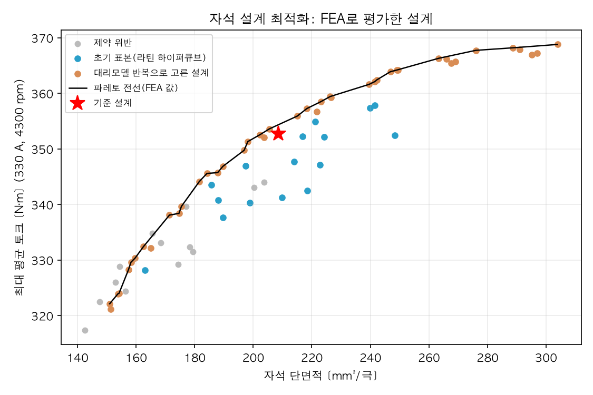

# Motor Lab

EV 구동용 매입형 영구자석 동기전동기(IPMSM)를 "설계 변수 → dq 모델 → 운전 영역(MTPA·약계자) → 효율맵 → 주행 사이클 전비"까지 한 흐름으로 계산하는 해석 도구입니다. 계산은 순수 Python 엔진(NumPy·SciPy)이 맡고, 결과는 공개 실측(ORNL의 2004 Toyota Prius 구동모터)과 FEA(xfemm)로 검증한 뒤 3D 웹 화면에 보여 줍니다. 모든 상수와 재료값에는 출처와 단위를 달고, 맞지 않는 결과도 원인 탐색 과정과 함께 숨기지 않고 기록합니다.

## 진행 현황 (갱신: 2026-11-23)

| 단계 | 내용 | 상태 |
| --- | --- | --- |
| P1 엔진 코어 M1·M2 | dq 모델, MTPA, 약계자, 토크-속도 곡선 | 완료 (해석해 테스트 통과) |
| P2 M3 손실·효율맵 | 동손, 철손, 기계손, 효율맵 40×60 1.5초 | 완료 |
| P3 FEA 연동·검증 | xfemm 전체 모터 모델, dq 자속 맵, ORNL 실측 비교 | 완료, **G1 관문은 미달** (고속 효율 +10%p) |
| P4 M4 전비·화면 | WLTP·UDDS·HWFET 전비, FastAPI, React 3D 스튜디오, Electron 셸 | 구현 (화면은 사용자 검토 중, 설치 파일 미검증) |
| P5 M5 자석 소재·감자 | 제조사 데이터시트 곡선, 온도별 무릎점, 소재별 토크·전비, FEA 감자 확인 | 완료 |
| 예제 모터 비교 | 연구실 예제 IPMSM을 xfemm으로 풀어 JMAG와 비교 | 역기전력·토크·전압·THD 1.1% 이내 일치(리플 4%), 철손 −24%(효율 +0.13%p, 메시·점 밀도와 무관 확인), 코깅 +40%는 강판 투자율로 +18%까지 설명, 나머지 미확인 |
| P5 M6 최적화 | GP 대리모델 + NSGA-II, 예제 모터 자석 5변수, FEA 73개 설계 | 완료 (기준 설계가 이미 전선 근처, 자석 −16%에 토크 −3.7%) |
| P5 M7 열 모델 | 권선·철심 2노드 열회로, 동손 온도 되먹임, ORNL 열관리 시험(연속 4점, 첨두 5곡선)으로 보정·검증 | 완료 (연속 ±5 K, 첨두 곡선 RMS 2.6 K 이하 뺀-하나 검증, 자석 노드 없음) |
| P5 M8 권선 전환 | 턴 수 비 a 결선 모델(직렬↔병렬, Y↔Δ), 결선별 효율맵과 최적 전환 비교, Prius 가정 계산 | 완료 (모델·불변량 테스트; 전환 전비 이득은 WLTP +0.28%로 작고 고속 출력 이득이 핵심, 고속은 G1 영향권) |
| P6 정리·보완 | 검증 보고서 최종본, 면담 준비 | 예정 |

**핵심 결과**
- ORNL Prius 잠금 토크 FEA/측정 0.94~1.00, 무부하 공극 자속밀도 일치. 모터 효율은 물리 모델이 주요 영역에서 +3.7%p, 4000 rpm 이상에서 약 +10%p 높다(G1 미달, 원인 탐색 중).
- WLTP 전비 약 10 km/kWh(모터 입력 기준, 순수 전기 구동 환산). 자석 소재(N45SH, N38UH)를 바꿔도 WLTP는 ±0.6% 이내이고, 핵심은 고온 감자 여유다(N45SH 150 °C는 최대 토크 전류에서 무릎점을 넘는다).
- 연구실 예제 모터(8극 48슬롯)를 JMAG 결과와 비교하면 상 역기전력 첨두 −0.4 %·실효 −1.1 %, 역기전력 THD 15.26 % 대 15.10 %, 평균 토크 +0.4 %, 토크 리플 8.53 % 대 8.22 %, 단자 전압 0.0 %, 철손 571 W 대 751 W(−24 %, 메시·점 밀도를 바꿔도 559~571 W), 효율 96.38 % 대 96.25 %다. 코깅 토크는 JMAG보다 40~50% 크지만 강판 저자계 투자율을 물리적 상한으로 키우면 +18%로 줄어든다(남는 차이 원인 미확정). (적층률 97%가 FEA에 전달되지 않던 버그를 고친 뒤 다시 계산한 값이다.)
- 열 모델(M7): 사이클에서 권선은 경계 온도보다 최고 9~15 K 올라가고, 동손 온도 되먹임으로 전비가 WLTP −0.4~+0.5%, UDDS −1.1~+1.3% 변한다(경계 60~115 °C 시나리오). ORNL 연속 시험 권선 온도 ±5 K, 첨두 곡선 뺀-하나-검증 RMS 2.6 K 이하.
- 권선 전환(M8, 가정 계산): 이 모터에 2병렬 또는 Y→Δ 전환이 있다면 5000 rpm 이상 최대 출력이 약 60 kW에서 약 105 kW로 늘고(저속 토크는 330 → 180~208 N·m로 감소) 사이클 전비는 WLTP +0.28%, UDDS/HWFET +0.00%에 그친다. 고속 결과는 G1 영향권이라 낙관적일 수 있다.
- 설계 최적화(M6): 예제 모터의 자석 치수 5개를 FEA 73개 설계로 탐색한 파레토( 참고). 원 설계가 이미 전선 근처이고, 자석 −16%에 토크 −3.7%, −28%에 −8.7%, +46%에 +4.6%(제약: 전압 433 V, 150 °C 감자 여유 ≥ 0.05).
- Prius 강판 곡선·적층률 불확실성(±4%)으로는 G1의 고속 필요 전류 불일치(약 28%)가 설명되지 않는다.
- 역추론으로 확인한 것: (1) 예제 모터 철손 −24%의 부족분(150~190 W)은 50 Hz 1.5 T 이상 손실이 카탈로그 W15/50의 12~15%인 크기와 같다(그럴듯하나 35JN230 실제 값은 못 구함). (2) G1 고속 불일치를 직렬 누설 인덕턴스로 설명하려면 중앙값 1.4 mH가 필요해(Ld 1.92 mH) 엔드턴 누설 가설은 지지되지 않는다. (3) 페라이트 Y30H-1의 사양 범위가 F33 최소값을 포함해 F33 판정(Prius 형상 비가역 감자)이 유지된다.
- 페라이트(Goudsmit F33의 제조사 추정 곡선)는 Prius 형상에서 최대 토크 전류에 비가역 감자된다(NdFeB용 형상이라 자석 두께 부족).

**알려진 한계** (자세한 내용은 `docs/validation_report.md`): 고속 필요 전류와 효율 미해결, 3D 효과·엔드턴 누설 없음(2D), 자석 온도는 상수(열 모델 M7 전), 페라이트 감자 판정 불가(자료 미확보), 데모 배포·설치 파일 미검증.

## 검증 한눈에 보기


(a) 잠금 토크와 (b) 공극 자속밀도는 FEA가 ORNL 실측과 맞고, (c) 효율과 (d) 필요 전류는 저속에서는 맞지만 고속에서 물리 모델이 실측과 **맞지 않는다**(G1 미달). 교정에 쓴 값은 자석 Br 1.06 T 하나이다. 그림은 `python notebooks/11_validation_figures.py`로 다시 만든다. 한계와 원인 탐색은 `docs/validation_report.md`, 컨택용 2쪽 요약은 [docs/summary.pdf](docs/summary.pdf)(원본 `docs/summary.html`).

테스트: `.venv/bin/python -m pytest` → 199개 통과(엔진 코어, 손실, 전비, API, 파형, 자석 M5, 강판 철손, 예제 모터, 설계 최적화 M6, 열 모델 M7, 권선 전환 M8, API 확장).

- 기획서: `docs/PLAN.pdf`
- 엔진 설계서: `docs/ENGINE_SPEC.md`
- 수식 유도: `docs/derivations.md`
- 검증 노트북: `notebooks/01_operating_region.ipynb` (T-N 곡선, dq 전류 평면), `notebooks/02_efficiency_map.ipynb` (효율맵, 손실 분포)
- 3D 스튜디오(P4): `web/` (React + TypeScript + react-three-fiber), 서버 `api/main.py`(FastAPI), 데스크톱 셸 `web/electron/`. 초안은 `web/prototype/index.html`(검증되지 않은 참고용)
- 자석 소재·감자(M5): `engine/magnet.py`, 자료 `data/materials/`(제조사 출처), 결과표 `notebooks/12_prius_magnet_check.py`, 소재별 토크·전비 `notebooks/13_prius_magnet_compare.py`
- 연구실 예제 모터 대 JMAG 비교(해석기끼리): `femm/example_motor.py`, `notebooks/14_example_motor_vs_jmag.py`(역기전력·토크·전압), `notebooks/15_example_motor_iron_loss.py`(철손·효율)
- 설계 최적화(M6): `engine/optimize.py`, FEA 평가기 `femm/design_opt_run.py`, 표 `data/fea/design_opt_evals.csv`, 결과 `notebooks/16_example_motor_pareto.py`
- 열 모델(M7): `engine/thermal.py`, 자료·보정 `data/thermal/`, 검증 `notebooks/19_prius_thermal.py`
- API 확장(M5~M8): `api/extensions.py` — `GET /api/magnets`, `GET /api/magnet_demag`, `POST /api/thermal_cycle`, `POST /api/winding`, `GET /api/pareto` (엔진 결과만 돌려주고 한계를 응답에 싣는다, 화면 연결은 사용자 화면 검토 뒤)
- 권선 전환(M8): `engine/winding.py`, 가정 계산 `notebooks/20_prius_winding_switch.py`
- 전비 계산: `notebooks/10_prius_fuel_economy.py`, 차량·사이클 데이터 `data/vehicles/`, `data/cycles/`

## 실행
```bash
uv venv --python 3.12 .venv
uv pip install --python .venv/bin/python -e ".[dev]"
.venv/bin/python -m pytest

# 화면 (P4): API 서버가 빌드된 화면까지 낸다
uv pip install --python .venv/bin/python -e ".[api]"
(cd web && npm install && npm run build)
.venv/bin/python -m uvicorn api.main:app --port 8000     # http://127.0.0.1:8000
# 또는 데스크톱 앱 창(Electron)으로: 엔진 서버를 알아서 띄우고 닫는다
(cd web && npm run desktop)
```
개발 중에는 `(cd web && npm run dev)`로 5173 포트에서 열면 `/api`가 8000으로 넘어간다.

### 스튜디오 화면
- **3D 모터**: 하우징(워터재킷, 볼트, 냉각 포트), 앞뒤 덮개, 3상 단자부, 고정자 철심(적층 무늬), 3상 권선(엔드턴 포함), 회전자, V자 자석 16개, 축·스플라인, 베어링, 레졸버. 치수는 ORNL 출처 값으로 그렸고, 출처가 없는 부품(단자부, 레졸버, 베어링)은 목록에 "도식"으로 표시한다.
- **해부**: 분해 슬라이더와 7단계 투어(하우징 → 고정자 → 회전자 → 자석 → 단면). 부품을 누르면 카메라가 날아가 출처가 있는 부품 도감을 보여 준다. X-ray, 숨기기, 단면(절단 위치 조절).
- **FEA 자속 분포**: 단면에 xfemm으로 푼 자속선과 자속밀도(무부하, MTPA 150·250 A, 약계자).
- **운전점**: 속도·토크를 정하면 엔진이 전류·전압·손실·효율을 풀고, 모터가 돌며 코일이 3상 전류로 빛난다. 효율맵을 누르면 그 점이 운전점이 된다.
- **전비·드라이브 모드**: WLTP·UDDS·HWFET를 달리며 속도·회전수·토크·전기 동력·효율 계기를 본다(실험적: 모터 입력 기준).
- **GPU 가속**: WebGL2, 인스턴싱(자석·볼트·베어링 볼), 적층 무늬와 냉각수 입자는 셰이더 계산, 움직임이 없으면 그리지 않는 요청 시 렌더, 고성능 GPU 요청, 프레임이 떨어지면 해상도 자동 하향. 설정 탭에서 GPU 이름과 fps를 본다.

### 데스크톱 앱(DMG/EXE)
`web/electron/main.cjs`가 엔진 서버를 빈 포트에 띄우고 화면을 연다(GPU 가속 플래그 포함). 개발 모드(`npm run desktop`)는 이 저장소에서 점검했다(창이 뜨고 API가 응답하고 종료 시 서버가 같이 꺼진다). 설치 파일은 `scripts/build_sidecar.sh`(PyInstaller로 엔진 서버를 한 파일로)와 `cd web && npm run desktop:build`(electron-builder: mac DMG, Windows NSIS, Linux AppImage)로 만들도록 설정했지만 **설치 파일 생성은 아직 끝까지 검증하지 않았다.**
