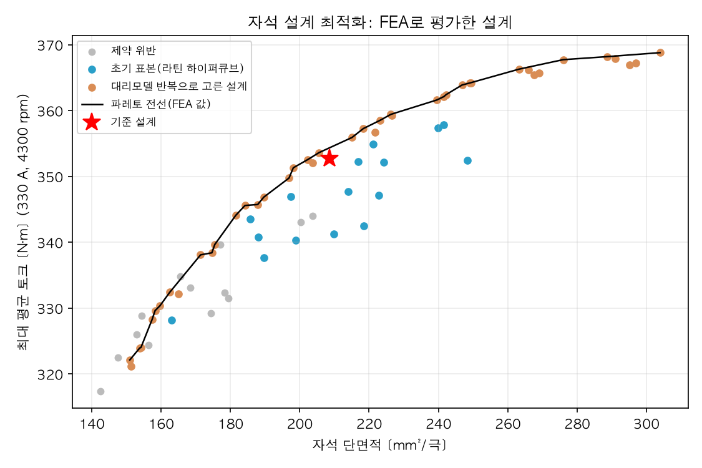

# 검증 보고서 (G1 관문 평가)

2026-11-22 작성. 기획서 6장의 V1~V4와 9장의 G1을 평가한다. **G1은 통과하지 못했다.** 통과 기준에 미달한 항목은 원인과 함께 적는다(기획서 9장: "충족 또는 미달 항목의 원인을 보고서에 기록"). 형상·자석·철심은 제3자 모델이고 ORNL 원문 값이 아니다(`data/benchmarks/prius2004_ornl.md`).

> 이 문서 아래쪽 "재평가" 절에 ORNL 형상·포켓 가설 결과가 있다(판정은 같고 원인 분해가 달라졌다).

## 요약

| 단계 | 기준(초안) | 결과 | 판정 |
| --- | --- | --- | --- |
| V1 해석해 | 오차 0.1% 이내 | T1~T8 통과 | 통과 |
| V2 교재 예제 | 교재 값과 일치 | 교재가 없어 전력-부하각식으로 대체 | 대체 통과 |
| V3 FEA 교차 확인 | 토크 오차 5% 이내 | 자속 기반 토크와 FEA 토크 중앙 −2.6%, 범위 ±6% | 대체로 통과(최대 6%) |
| V4 토크 | 10% 이내 | 잠금 토크 최대값 0.99~1.09배, 250 A에서 337 대 337 N·m | 통과(잠금 토크만) |
| V4 효율 | 주요 영역 3%p 이내 | **주요 영역 평균 +3.07%p, 3%p 이내 52%, 고속 +8.6%p** | **미달** |

## V1·V2 (해석해와 교재 공통 식)

`tests/test_v1_analytic.py` T1~T8과 `tests/test_p2_losses.py`가 통과한다(MTPA 해석식, 기저속도, 최고속도, 전력 수지, MTPV 포함). V2는 주 교재가 없어 교재마다 같은 돌극 동기기 전력-부하각식을 정답지로 썼다(`tests/test_v2_textbook.py`). 교재 수치 예제는 아직 없다.

## V3 (엔진 대 FEA)

FEA 도구는 xfemm이고 진짜 FEMM과의 직접 비교는 하지 못했다(`docs/FEA_OPTIONS.md`). 해석해 시험에서 선형·영구자석·비선형 BH가 모두 수렴했다.
- **회전 문제:** xfemm의 공극 요소(AGE) 회전이 큰 각도에서 부정확해(원인 미규명) 전체 모터 모델(공극 메시)로 대체했다. 무부하에서 위상 오차 ≤ 0.7°, 대칭 정확, 코깅 ±0.25 N·m.
- **교차 확인:** 전체 모델 맵에서 자속 기반 토크 `1.5p(ψd·iq − ψq·id)`와 두 위치 평균 Henrotte 토크가 중앙 −2.6%, 범위 −6~+6%로 일치한다(기준 5%를 6%가 조금 넘는다). 엔진은 이 자속 맵을 읽어 토크를 자속에서 계산하므로, 엔진 대 FEA 비교는 이 일치로 갈음한다.
- **수치 수렴:** 메시 4종(요소 10.4만~16.8만)으로 무부하와 부하점 `(id, iq) = (−100, 150) A`를 풀었다. 맵에 쓴 기준 메시(11.2만)와 가장 촘촘한 메시(16.8만)의 차이는 `ψd` −0.05%/+0.13%, `ψq` −0.11%, 자속 기반 토크 −0.07%다(거친 메시도 0.6% 안). **FEA 자속 맵은 수치적으로 수렴했으므로 ORNL 실측과의 차이는 수치 오차가 아니라 모델 오차(형상·자석·철심 값, 2D 가정, 모델에 없는 손실)다.**
- **한계:** 2D 해석이라 엔드턴 누설이 없고, 슬롯 맥동은 두 위치 평균으로만 줄였다.

## V4 토크 (잠금 회전자)

ORNL의 잠금 회전자 시험을 모사했다(상전류 `(Ia, −Ia/2, −Ia/2)` 직류, 회전자 각도를 돌려 토크-각도 곡선). 전류 7개(50~250 A)로 비교한다.
- **전류별 최대 토크**(FEA / TM-423 Fig. 3.10): 0.99~1.09, 중앙 1.04. 250 A에서 FEA 362 N·m(실측 337 N·m 2005년, 400 N·m 2004년).
- **토크-각도 곡선 모양:** 영점 하나(250 A에서만 결정)와 **거울 방향 가정**으로 7개 전류 모두 상관계수 0.991~0.996, RMS 6.7~9.3%. 거울 방향은 ORNL 보고서에 없는 가정이다.
- **자석 Br 보정:** 제3자 Br = 1.24 T는 무부하 자속을 ORNL 환산값(0.174 Wb)보다 21% 크게 만들었다. **Br만** 1.056 T로 무부하 역기전력에 맞췄다(보정). 보정에 쓰지 않은 값으로 확인했다: 250 A MTPA 토크 337 N·m(실측 337), 저속 필요 전류 엔진/측정 0.99(범위 0.96~1.03, 보정 전 0.92).
- **맞지 않는 것:** 75 A 잠금 토크가 실측(118~140)보다 13% 낮다(103 N·m). 고속 필요 전류는 엔진이 측정의 0.61~0.94배(중앙 0.72)만 예측한다.
- **비교하지 않은 것:** 최대 토크-속도 곡선. ORNL Fig. 3.17은 Toyota 공표 곡선이지 실측이 아니다.

## V4 효율 (미달)

**방법.** ORNL Table B-1의 모터 효율(`η = P_mech/P_ac`, 인버터 손실 제외) 397행(속도 ≥ 500 rpm) 중 엔진이 풀 수 있는 382행과 비교했다(나머지 15행은 전류 250 A 또는 전압 한계 밖). 행마다 (속도, 샤프트 토크)에서 전류가 최소인 동작점을 풀고 `loss_breakdown`으로 효율을 계산했다(`notebooks/03_prius_efficiency_validation.py`). 보정한 자속 맵, 행별 실측 권선 온도의 `Rs(T)`, DC 전압, `k_mod = 2/π`(실측 전압이 육각파 한계에 있어 맞다)를 썼다.

**손실 계수와 출처** (근거는 `data/benchmarks/prius2004_ornl.md` 9절):
- 철손 `P = Σ m·(k_h·f·B^β + k_e·f²·B²)`: pyleecan의 M400-50A 손실 데이터(`f ≤ 400 Hz`, 55점)에서 피팅(`k_h = 0.0241`, `k_e = 1.77e-4`, `β = 1.74`, 중앙 오차 5.4%, 최대 15%). 질량은 형상에서 계산(치 6.5 kg, 요크 9.3 kg). `B = c·|ψ|`의 `c`는 FEA 프로브로 구했다(치 6.14 T/Wb, 요크 4.62 T/Wb; 상태에 따라 치 ±8%, 요크 ±15%). 부하에서 치 자속밀도가 2.0~2.2 T까지 올라가 손실 데이터 범위(1.8 T)를 넘는 외삽이 포함된다.
- 기계손 `a·ω + b·ω³`: TM-423 Table 3.7 모터 로터 손실 피팅(`a = 0.44`, `b = 7.8e-7`, 윤활유 25 °C).
- 상저항 `R20 = 65 mΩ`: 속도 < 400 rpm, 토크 > 100 N·m인 17행은 손실이 거의 전부 동손이라 `3·I²·R(T)`로 역산했다(범위 61~72 mΩ, 권선 온도에 따른 경향 없음 → 온도계수 0.00393이 맞다). 도체 정보로 추정한 값(49~56 mΩ)보다 높다. **`R20`은 같은 ORNL 표에서 구했으므로 효율 비교는 `R20`에 대해서는 완전한 독립 검증이 아니다.** 역산에 쓴 영역(< 400 rpm)은 비교에서 제외했다(속도 ≥ 500 rpm만 비교).

**결과.**

| 구분 | 행수 | 실측 η | 엔진 η | Δη 평균 | Δη RMS |
| --- | --- | --- | --- | --- | --- |
| 전체 | 382 | 88.5% | 91.5% | **+3.00%p** | 3.93%p |
| 500~1000 rpm | 94 | 83.6% | 85.0% | +1.46 | 2.17 |
| 1000~2000 rpm | 146 | 89.8% | 91.9% | +2.02 | 2.56 |
| 2000~3000 rpm | 73 | 92.2% | 95.4% | +3.21 | 3.45 |
| 3000~4000 rpm | 34 | 90.8% | 95.9% | +5.15 | 5.29 |
| 4000~5000 rpm | 15 | 88.0% | 95.7% | +7.71 | 7.79 |
| 5000~6100 rpm | 20 | 85.7% | 95.1% | +9.33 | 9.41 |
| 토크 200~300 N·m | 74 | 84.4% | 85.3% | +0.90 | 1.25 |
| 토크 0~60 N·m | 97 | 89.3% | 95.1% | +5.80 | 6.22 |
| **주요 영역(1000~4000 rpm, 30~200 N·m)** | 185 | | | **+3.07** | 3.41 |

주요 영역에서 |Δη| ≤ 3%p인 행은 52%, 최대 |Δη|는 7.8%p다. 최고 효율점은 실측 95.0%(2303 rpm, 111 N·m), 엔진 96.6%(3804 rpm, 60 N·m)로 위치도 다르다.

**판정: 미달.** 엔진은 효율을 체계적으로 높게 예측하고(+3.0%p), 오차가 속도에 따라 커진다(+1.5 → +9.3%p). 동손이 지배적인 저속·고토크(200~400 N·m)는 잘 맞지만 이 구간은 `R20` 역산 구간과 가까워 독립 검증이라 하기 어렵다.

**원인 분석** (실측 값만으로 분해):
- 측정 총손실에서 "측정 전류로 계산한 동손"을 빼면 남는 "철손 + 기계손 + 기타"가 모델의 **약 3배**다(500~4000 rpm에서 2.8~3.1, 4000 rpm 이상에서 4.1). 속도에 따라 일정한 배율이라 **모델에 없는 손실이 철손 크기에 비례해 따라붙는 모양**이다. 후보는 자석 와전류 손실, PWM 고조파 손실, 스트레이 손실, 가공·응력으로 인한 철손 증가다. 이 손실들은 모델링하지 않았고 확인하지 못했다. 인수 3은 설명이 아니라 진단이다.
- 고속에서는 동손 부족도 일부 기여한다(5000~6100 rpm에서 부족분 2.59 kW 중 0.38 kW). 앞서 본 고속 필요 전류 과소 예측(엔진/측정 0.72)과 같은 현상이다.
- **동작점 선택 방식은 원인이 아니다.** ORNL 제어기는 id를 바꿔 효율이 가장 높은 점을 골랐고 엔진 기본은 전류 최소 점이라, 고속 필요 전류 과소 예측이 이 차이에서 올 수 있다고 의심해 `optimal_current(objective="loss")`를 구현해 확인했다(`notebooks/04_prius_operating_point_objective.py`). 효율 오차는 그대로다(전체 +3.00 → +3.02%p, 고속 +8.64 → +8.65%p). 고속 필요 전류 비율은 0.77 → 0.80으로 거의 변하지 않았고, 최적화에 쓰는 철손을 2배, 3배로 키우면 0.86, 0.92가 되지만 점별 범위가 0.61~1.76으로 벌어진다. 철손 계수를 키운 경우에도 효율 오차는 안 줄었다(+2.92%p). 이 결과는 "모델에 없는 손실이 있다"는 방향과 맞지만 점별 편차가 커서 그것으로 설명됐다고 말할 수 없다.
- **민감도:** 현실적인 계수 불확실성(`R20` 0.049~0.072 Ω, 기계손 ±20%, 자속밀도 계수 ±15%)을 바꿔도 주요 영역 평균은 +2.7~+3.9%p다. 진단용으로 철손 계수를 2배, 3배로 키우면 주요 영역 평균이 +2.2, +1.4%p가 되고 3%p 이내 비율이 77%, 89%가 되지만 4000 rpm 이상은 +6.2%p가 남는다. 철손 하나로는 설명되지 않는다. **어떤 계수도 이 결과에 맞추려고 조정하지 않았다.**
- 알려진 한계: 측정 모터 입력은 PWM 인버터 출력이라 고조파 손실을 포함하지만 엔진은 정현파 모델이다. 엔드턴 누설이 없어 고속 자속 특성이 다르다.

## 재평가 (2026-11-22, ORNL 해체 측정으로 입력 교체)

위 평가 뒤에 ORNL 문서에서 입력과 검증 자료를 더 찾아 모델을 바꿨다(`data/benchmarks/prius2004_ornl.md` 10~13절, `docs/FEA_OPTIONS.md` 3-6절). 판정은 달라지지 않았고 원인 분해가 달라졌다. **이 절은 앞서 기록한 "포켓 가설"을 정정한다**: TM-2010/253이 자석이 6.5 mm 두께 전체임을 해체 측정으로 확인해서, 5.31 mm 자석이 포켓 안에 있다는 가설은 폐기했다.

**채택한 모델.** 해체 치수 형상(자석 18.9 × 6.5 mm, 공극 0.73 mm, 적층 83.6 mm, 슬롯 개구 1.93 mm, 모두 ORNL 측정) + 자석 Br **교정값 1.06 T**(시료 곡선 1.243 T보다 15% 낮음) + 상 저항 측정값 0.069 Ω(21 °C).
- **Br 교정은 독립 측정 세 개가 확인한다.** 무부하 역기전력(교정에 사용), 공극 자속밀도 파형(측정/FEA 크기비 1.007, 파형 RMS 4%), 잠금 토크 75 A의 PM 성분(모델 0.1756 Wb, 측정 0.1769 Wb; 150 A 이상은 모델이 5~7% 작다). 15% 약한 이유는 모른다.
- **잠금 토크 최대값** FEA/측정 0.941·0.940·0.996 (75·150·250 A, 교정에 쓰지 않음), 곡선 모양 상관 0.996~0.997, RMS 4.6~5.8%.
- **저속 필요 전류** 엔진/측정 1.01(범위 0.93~1.04).
- **R20 독립:** 측정 저항 0.069 Ω은 표에서 역산한 65 mΩ과 6% 안에서 일치한다. 효율 비교가 R에 대해 독립이 되었다.

**손실 모델의 이중 계산을 찾았다.** TM-423 표 3.7 "모터 로터 손실"은 무부하 철손을 포함한다(로터 낀 구성 − 로터 뺀 구성). 이전 모델은 이것을 기계손으로 쓰고 철손을 또 더해 무부하 손실을 1.7~2.5배로 셌다. 이중 계산을 없애면(V1) 효율 오차가 **더 커진다**(주요영역 +2.84 → +3.70%p): 모델에 없는 손실이 그만큼 더 크다.

| 모델 (380행) | 주요영역 평균 Δη | 3%p 이내 | 고속(≥4000 rpm) Δη |
| --- | --- | --- | --- |
| V0 이전(이중 계산) | +2.84%p | 56% | +8.57 |
| V1 이중 계산 제거 | +3.70%p | 41% | +9.87 |
| V2 경험식 포함 | +0.20%p (전체 RMS 1.47) | 98% | +1.82 |

경험식 V2 `P = k_f·f + k_c·Is_rms²·f²`(`k_f = 3.50 W/Hz`, `k_c = 4.9e-6 W/(A²·Hz²)`)는 같은 벤치마크 행에 맞춘 보정이다. 행을 무작위 반으로 나눠 맞추고 나머지로 평가해도 1.49%p다. **3000 rpm 미만 행으로 맞추고 이상 행을 평가하면 평균 +3.3, RMS 3.7%p**로 나빠지므로 계수는 시험 범위 안에서만 의미가 있다. 엔진은 `ExcessLossParams`로 받고 기본값을 두지 않으며, 계수와 검증 결과는 `data/fea/prius2004_excess_loss_fit.json`에 있다. **동작점 선택(손실 최소점)은 여전히 원인이 아니다**(`notebooks/04_*`, 효율 오차 불변).

**G1 판정.** 물리 모델만(V1)은 미달이다. 경험식 포함은 기준(주요영역 3%p 이내)을 넘지만 같은 벤치마크에 맞춘 보정이라 G1 충족으로 세지 않는다(사용자 결정, 2026-11-22). P4는 시작하지 않았다.

## 원인 탐색 (2026-11-22)

재현: `notebooks/07_prius_excess_loss_structure.py`, `08_prius_high_speed_current.py`, `09_prius_sine_supply_check.py`. 잔여 손실 = 측정 총손실 − 동손(R20 68.7 mΩ) − 무부하 실측 손실.

**확인한 것**
1. **인버터 없이 정현파 전원으로 돌린 시험에는 잔여 손실이 없다.** ORNL 열관리 보고서(TM-2005/33 표 4~6)의 900 rpm·60 Hz 시험에서 측정 전류로 동손을 계산하고 구동계 마찰 160 W를 빼면 남는 손실이 토크 60 N·m 이상에서 중앙값 −54 W(입력 전력의 0.5%), 범위 −168~+5 W다. 같은 속도의 인버터 시험(표 B-1)은 약 2 N·m × ω ≈ 200 W가 남는다. 같은 모터를 같은 연구소에서 잰 두 시험이라, 잔여 손실은 인버터 구동(PWM 고조파 등)이 만든 것일 가능성이 가장 크다. 단 시험대(기어 유무, 토크게이지 위치)가 달라 측정 장치 차이를 완전히 배제하지는 못한다. 정현파 시험의 권선 온도는 열전대(최고 쪽)라 구리 손실이 과대평가되어 ±100 W 정도 불확실하다.
2. **무부하 손실을 자속으로 키워도 소용없다.** 부하에서 자속이 무부하의 1.1~1.9배가 되므로 무부하 손실을 `(|ψ|/|ψ0|)^β`로 키워 봤다(β = 1, 1.74, 2). 주요영역 오차는 +3.72 → +3.53, +3.34, +3.26%p로 조금만 줄고 3%p 이내 행은 41 → 48%다.
3. **3000 rpm 미만의 잔여는 속도에 비례하는 상수 토크로 설명된다: `잔여 = ω·(2.23 N·m + 0.12%·T)`.** 출력에 비례하는 항은 거의 없고(저항을 측정값으로 바꾸기 전에는 0.64%) 2.2 N·m의 마찰 토크 형태다. 이 두 계수로 3000 rpm 미만 행의 효율 오차가 평균 +0.12%p, RMS 1.26%p가 된다. TM-423 표 3.7의 기계손(500 rpm에서 0.4 N·m)의 5배다. 정현파 시험에는 이 항이 없어 1번과 같은 방향의 증거다.
4. **3000 rpm 이상에서는 앞의 항 위에 약 3~4 W/Hz(670~1440 W)가 더 남는다.** 이 영역은 전압이 육각파 한계에 닿고 약계자가 시작되는 곳이다.
5. **고속 필요 전류(엔진/측정 0.72~0.77)에 대해.** 3000 rpm 이상 69행에서 측정 전류·토크를 만족하는 약계자 쪽 해의 모델 전압이 육각파 한계의 0.75배(0.65~0.96)다. 측정 전압(총 실효 약 240 V)이 한계에 있다면 모델의 자속이 깊은 약계자에서 실제보다 작다는 뜻이고, 측정 전압이 PWM 고조파 포함 총 실효값이라 기본파는 한계보다 낮을 수도 있다. 자료만으로는 가르지 못했다. 이 값이 1에 가까워지도록 맵을 바꾸면 보정이라 하지 않았다. 엔진의 전압 한계 `2Vdc/π`(상 피크 318 V)는 ORNL이 적은 500 V 육각파 선간 실효 390 V와 맞다(318 × √3/√2 = 390 V).
6. **손실 최소 동작점 선택이 원인이라는 가설은 기각했다.** 같은 동작점에서 잔여 손실은 자속에 의존하지 않는다(`f·ψ²`는 R² < 0, 거듭제곱 맞춤은 `ψ^-1.9`로 자속이 낮을수록 손실이 크다). `k_f·f + k_c·I²f²`(측정 전류)는 R² = 0.947이다. 손실이 전류에 따라 커지므로 손실을 줄이려는 제어기는 전류가 더 큰 약계자를 고르지 않는다.

**확인하지 못한 것과 이유**
- 인버터가 만든 손실의 크기를 가릴 데이터가 공개 ORNL 문서에 없다: 2004년 인버터의 PWM 반송파 주파수·데드타임·변조 방식, 토크셀 사양·교정(위치는 TM-423 sec 3.3.2에 있음), 도체 가닥 배치, 자석 분할 여부, 강판 등급과 손실 곡선.
- 높은 부하에서 모델이 정현파 시험보다 전류를 더 요구한다(모델/측정 전류 1.12~1.15, 70 N·m 이상). 슬롯 면적 불확실성(`docs/FEA_OPTIONS.md` 3-6절 4)과 강판 포화 특성이 후보이다.

**(2026-11-23 재해석: 이 방향의 증거는 아래 "잔여 손실 재해석" 절에서 약해졌다.)** **G1 판정은 바뀌지 않는다.** 정현파 시험 결과로 잔여 손실이 모터 자체의 손실이 아니라 인버터 시험 조건과 관련이 있다는 방향이 강해졌지만, 인버터 조건을 모르는 채 그 손실을 모델에 넣을 수는 없다.

## 전비 (P4, 2026-11-23)

`notebooks/10_prius_fuel_economy.py`. **G1 미달을 기록한 채 P4를 진행했다**(사용자 결정). 이 전비는 모터 입력(교류) 기준 전기 에너지이고 인버터·배터리·보조 부하를 포함하지 않으며, 실제 Prius는 엔진을 같이 쓰므로 "순수 전기 구동 환산"이다. 차량 값은 EPA 2004 Prius 시험 차량 기록(등가 질량 1474 kg, 도로 부하 88.6 + 1.384·v + 0.3643·v² N), 모터-차속 비는 ORNL(60.66 rpm/mph)에서 왔다(`data/vehicles/prius2004.json`).

| 모델, 권선 100 °C | WLTP (회생 100% / 0%) | UDDS | HWFET |
| --- | --- | --- | --- |
| 물리 모델 | 10.00 / 7.37 km/kWh (100 Wh/km) | 14.16 / 8.43 | 10.30 / 9.27 |
| 경험식 포함 (보정) | 9.03 / 6.92 (111 Wh/km) | 12.46 / 7.96 | 9.37 / 8.57 |

- **이 숫자를 얼마나 믿어도 되는가.** 검증에서 물리 모델은 효율을 주요 영역(1000~4000 rpm)에서 +3.7%p, 4000 rpm 이상에서 약 +10%p 높게 예측했다. 도심(UDDS)은 대부분 저속·중속이라 비교적 믿을 만하고, 고속 구간이 긴 WLTP·HWFET는 낙관적일 수 있다. 경험식 포함 값이 하한 쪽이지만 같은 벤치마크에 맞춘 보정이다.
- 권선 온도(60~150 °C)에 대한 민감도는 WLTP에서 1% 안이다. 회생 비율은 영향이 크다(WLTP 7.4 → 10.0 km/kWh). 회생 비율 100%는 모터가 제동 동력 전부를 받는 이상적인 값이고 배터리 충전 한계는 반영하지 않았다.
- 못 낸 구동 에너지는 WLTP에서 0%이다(모터가 사이클의 모든 가속을 낸다).
- 기어 손실은 무부하 값(25 °C 윤활유)뿐이라 부하 의존 손실이 빠져 전비가 약간 낙관적이다.

## M5 자석 소재·감자 검토 (P5, 2026-11-23)

`engine/magnet.py`, 자료 `data/materials/`(제조사 데이터시트, 출처 포함), FEA `femm/demag_check.py`, 결과표 `notebooks/12_prius_magnet_check.py`. **Prius 형상에 소결 NdFeB 등급을 넣은 가정 계산이다**(실제 Prius 자석 등급은 모른다). 모델 자석은 선형이라 무릎점 이후 비선형 감자는 모사하지 않는다.

**자료 점검.** N45SH·N38UH의 감자 곡선은 PDF 벡터 그림에서 읽었고, 20 °C 곡선의 Br·HcJ가 표 값과 일치한다(스크립트가 검사). 곡선 8개에서 구한 온도 변화율은 표의 α와 따로 맞는다: N45SH α(Br) 곡선 −0.120 %/°C 대 표 −0.12, α(HcJ) 곡선 −0.549 대 표 −0.55(카탈로그 −0.549), N38UH α(Br) −0.120 대 −0.12, α(HcJ) −0.510 대 −0.51(테스트 통과). 곡선의 HcB(1033 kA/m)는 표의 범위 979~1050 안이다.

**감자 여유 = 1 − H_demag/Hk** (자석 안 74점 중 최악 점, 회전자 0°, Hk는 J = 0.9·Br인 자계). 자석 온도는 상수로 준 값이다(열 모델 M7 전).

| 등급 | 온도 | 무부하 | MTPA 250 A | 순수 −d 250 A |
| --- | --- | --- | --- | --- |
| N45SH | 20 °C | +0.89 | +0.62 | +0.49 |
| N45SH | 100 °C | +0.85 | +0.37 | +0.13 |
| N45SH | 150 °C | +0.75 | **−0.19** | **−0.65** |
| N38UH | 20 °C | +0.93 | +0.70 | +0.59 |
| N38UH | 100 °C | +0.90 | +0.53 | +0.35 |
| N38UH | 150 °C | +0.85 | +0.21 | **−0.10** |
| N38UH | 180 °C | +0.75 | **−0.42** | **−0.96** |

해석: 150 °C에서 N45SH는 최대 토크 전류(250 A MTPA)에서 이미 무릎점을 넘는다. N38UH는 150 °C에서 MTPA 250 A는 버티고 순수 d축 250 A에서 넘는다. N38UH를 최고 사용 온도 180 °C에서 보면 MTPA 250 A에서도 무릎점을 넘는다(N45SH는 최고 사용 온도가 150 °C라 180 °C는 계산하지 않았다). 이는 소재 이름의 H·UH 등급 차이(HcJ와 최고 사용 온도 150 °C 대 180 °C)와 같은 방향이다. 이 결과는 최소 HcJ를 그린 곡선 기준이라 실제 자석이 약간 더 나을 수 있다.

**1단계 어림 검증 (기각과 대체).** 처음에는 "자석을 지나는 자속이 d축 쇄교자속 ψd/ψm에 비례한다"는 등가회로 가정으로 회복선을 따라 자계를 옮겼다. FEA 평균 자계와 비교하니 **+120~+190% 과대**였다(예: N45SH 20 °C MTPA 250 A에서 ψd/ψm = 0.08 → 기각된 식 965 kA/m, FEA 435 kA/m). IPM의 d축 전기자 자속은 대부분 자석이 아니라 회전자 철심을 지나기 때문이다. 대신 `H = H0 + κ·(−id)`(κ는 형상·권선 상수)를 쓴다. NdFeB 두 등급의 FEA 14점에서 κ는 온도와 무관하게 1.77~1.87 kA/m per A(±3%)였고(페라이트는 μr와 Br이 달라 약 15% 작다, 아래), κ를 한 점(N45SH 20 °C 순수 d축)에서만 구해 나머지 13점을 예측하면 오차가 −3.5%~+0.8%였다. κ는 이 형상의 상수이므로 다른 형상에는 FEA 두 점이 다시 필요하다.

**메시 민감도.** 최악 점 H(N45SH 100 °C, 순수 −d 250 A): 자석 요소 2 mm 750.6, 1 mm 750.5, 0.5 mm 769.0 kA/m(+2.5%). 평균은 530~534로 안정했다. 기본값(2 mm)의 최악 점은 모서리 첨두를 최대 약 2.5% 낮게 본다.

**자석을 바꿀 때의 자속 맵.** 소재를 바꿀 때마다 맵(121점 × 2위치, 40분)을 다시 풀 수 없어서, 단순 겹침 `ψd' = ψd + (k−1)ψm`(k = Br'/Br)을 먼저 FEA와 비교했다(`femm/magnet_scaling_check.py`, 전체 모터, 서로 다른 자석 두 가지, 각 7점). 기준 재현(Br 1.06 T)은 맵과 정확히 같았지만(장치 점검), 겹침은 N45SH 20 °C(Br 1.35 T)에서 ψd 최대 20.8 mWb, ψq 최대 15.6 mWb 어긋났다. 무부하 ψm은 μr가 달라 2.9% 낮았고, 큰 Br에서는 철심이 더 포화되어 ψq가 줄었다. 그래서 기준 형상에 Br 1.00 T와 1.40 T(μr 1.04) 자석을 넣은 맵 두 개를 50 A 간격(36점 × 2위치)으로 풀고(`data/flux_maps/prius2004_fullmodel_Br100_mur104_50A.csv`, `..._Br140_...`), `ψ' = ψ_기준 + Δ(Br)`(Δ = 가정 맵 − 기준 맵, 50 A 격자에서 Br 선형 보간 후 쌍선형으로 펼침, `engine.magnet.map_for_magnet`)로 바꿨다. 따로 푼 FEA 14점(Br 1.350 T와 1.018 T)에서 최대 오차는 ψd 1.0 mWb, ψq 0.8 mWb로 겹침(21 mWb)의 1/20이다(테스트 `tests/test_p5_magnet_maps.py`가 2 mWb로 고정).

**소재·온도별 토크·효율·전비** (`notebooks/13_prius_magnet_compare.py`; 권선 100 °C, 회생 1, 모터 입력 기준, 물리 모델 손실):

| 자석 | 온도 | Br [T] | ψm [Wb] | 250 A MTPA 토크 [N·m] | 6000 rpm 최대 토크 [N·m] | WLTP [km/kWh] | UDDS | HWFET | 감자 여유 MTPA 250 A / −d 250 A |
| --- | --- | --- | --- | --- | --- | --- | --- | --- | --- |
| 기준(Br 1.06 보정값) | - | 1.060 | 0.174 | 330 | 94 | 10.00 | 14.16 | 10.30 | - |
| N45SH | 20 °C | 1.350 | 0.228 | 384 | 128 | 10.06 | 14.60 | 10.34 | +0.62 / +0.49 |
| N45SH | 100 °C | 1.220 | 0.204 | 363 | 115 | 10.05 | 14.42 | 10.33 | +0.37 / +0.13 |
| N45SH | 150 °C | 1.139 | 0.189 | 350 | 106 | 10.03 | 14.31 | 10.32 | **−0.19 / −0.65** |
| N38UH | 20 °C | 1.260 | 0.211 | 370 | 119 | 10.06 | 14.48 | 10.33 | +0.70 / +0.59 |
| N38UH | 100 °C | 1.139 | 0.189 | 350 | 106 | 10.03 | 14.31 | 10.32 | +0.53 / +0.35 |
| N38UH | 150 °C | 1.063 | 0.176 | 338 | 98 | 10.01 | 14.19 | 10.30 | +0.21 / **−0.10** |
| N38UH | 180 °C | 1.018 | 0.167 | 331 | 94 | 9.99 | 14.12 | 10.29 | **−0.42 / −0.96** |

굵은 칸은 무릎점을 넘어 비가역 감자가 시작되는 조건이라, 그 행의 토크·전비는 감자 후에는 성립하지 않는다. 읽는 법: (1) 토크는 ψm에 비례해 늘고(250 A MTPA 331~384 N·m, 6000 rpm에서 94~128 N·m) 기저속도는 거의 그대로다(2110~2122 rpm). (2) WLTP 전비는 소재에 거의 둔감하다(9.99~10.06 km/kWh, 기준 10.00 대비 −0.1~+0.6%). UDDS는 14.12~14.60(−0.3~+3.1%). 강한 자석이 이득인 폭이 작은 이유는 손실을 분해해 확인하지 않았다(추정: 같은 토크의 전류 감소로 동손이 줄지만 고속 약계자 전류가 늘어 일부 상쇄). (3) 따라서 이 모터에서 자석 선택의 핵심은 전비가 아니라 **고온에서의 감자 여유와 토크 확보**다.

**페라이트 F33 (Goudsmit 등급표의 추정 곡선).** TDK 사이트는 자동 접근이 막혀 있어(403) 같은 계열의 다른 제조사 자료를 찾았다. Goudsmit Magnetics 페라이트 등급표(2025-08-22)는 F33(Br 0.39 T, HcB 239, HcJ 243 kA/m, α(Br) −0.18 %/°C, β(HcJ) +0.40 %/°C, Tmax 225 °C)의 값과 −40, 20, 225 °C 감자 곡선을 싣는다. **곡선은 제조사가 등급 데이터로 만든 추정이지 실측이 아니다**(시트가 밝힌다). 벡터 그림을 읽어(`data/materials/digitize_goudsmit_demag.py`) 20 °C Br 0.390 T와 HcJ 243 kA/m가 표와 같고, 225 °C·−40 °C 곡선이 시트의 온도계수에서 계산한 값과 맞는 것을 스크립트가 검사한다. Prius 형상에 F33을 넣으면 최대 토크 전류(MTPA 250 A)에서 자석 안 최대 감자 자계가 392 kA/m(20 °C)로 Hk 201 kA/m의 두 배라 **비가역 감자**다(여유 −0.95, −40 °C에서 −1.49, 순수 −d 250 A에서 −1.67~−2.40). 이 형상은 NdFeB용(자석 6.5 mm)이라 페라이트를 쓰려면 자석을 훨씬 두껍게 해야 한다는 뜻이고, 같은 전류로는 페라이트가 성립하지 않는다. 이때 감자 결합 상수 κ는 NdFeB(약 1.8 kA/m per A)보다 약 15% 작다(페라이트는 μr 1.10, Br이 작아 철심 포화가 다르다). 페라이트는 Br이 0.4 T대라 맵 보간 범위(1.00~1.40 T) 밖이어서 토크·전비는 계산하지 않았다.

**한계.** 회전자 위치 0°만 풀었다(슬롯과 자석의 상대 위치에 따른 변동 무시). 감자 후 회복(비가역 손실량)은 계산하지 않고 무릎점 도달 여부만 본다. 페라이트는 HcJ 온도계수와 곡선을 못 찾아 판정하지 않는다(`data/materials/magnets.json`의 `null`). 자석이 바뀌어도 무부하 철손은 Prius 자석으로 잰 기계손 곡선을 그대로 쓴다(자석 와전류·철손 변화 미반영). 자석 온도는 상수이고 열 모델(M7)과 연결하지 않았다. 맵 보간은 Br 1.00~1.40 T 안에서만 쓴다(밖은 오류).

## 연구실 예제 모터와 JMAG 결과 비교 (2026-11-23)

연구실 강의 자료의 예제 IPMSM(8극 48슬롯, 160 kW, 350 N·m @ 4300 rpm, 680 V, 적층 153 mm, 공극 0.8 mm, 자석 N45SH, 강판 35JN230)을 강의 자료의 MATLAB 코드(`param.m`)의 형상 수식으로 xfemm 전체 모터 모델로 만들고(`femm/example_motor.py`) JMAG 결과 화면의 값과 비교했다(`femm/example_motor_run.py`, `notebooks/14_example_motor_vs_jmag.py`, 테스트 `tests/test_example_motor.py`). **해석기끼리의 비교이고 실측이 아니다.** 강의 자료 파일은 저장소에 없다.

**형상 점검.** 코드 수식으로 옮긴 슬롯의 면적이 82.72 mm²로 강의 자료의 레이어 면적 82.71 mm²와 같다. 치폭 5.8, 요크폭 12.5, 슬롯 깊이 19.5 mm, 오프닝 1.4 mm, 자석 22.9 × 2.6 mm·14 × 3.2 mm(반쪽)도 같다(테스트).

**설정(JMAG와 같게 둔 것).** 자석 N45SH 50 °C(공칭 Br 1.301 T, μr 1.038, 곡선은 `engine/magnet.py`), 적층률 97%, 상저항 0.033 Ω(50 °C), 4300 rpm, 상전류 첨두 330 A, 쇄교자속은 직렬 32턴(슬롯당 도체 4가닥에 상전류를 흘림, 슬롯 기자력 4 × 330 = 8 × 165 A). 강판은 JFE 35JN230 대표값 네 점(B10~B100)에 그 밖의 구간은 Prius 곡선 모양을 붙인 것이다(`steel_bh`). 강판 곡선을 Prius 것으로 바꾸어도 토크 0.4%, 전압 0.3%만 달랐다. d축 기준 각은 무부하 A상 쇄교자속의 기본파 위상으로 정의했고 맞춘 값이 아니다.

| 항목 | xfemm | JMAG | 차이 |
| --- | --- | --- | --- |
| 상 역기전력 첨두 | 276.9 V | 277.96 V | −0.4% |
| 상 역기전력 실효 | 205.6 V | 207.76 V | −1.1% |
| 선간 역기전력 첨두 | 527.2 V | 521.39 V | +1.1% |
| 선간 역기전력 실효 | 353.6 V | 357.47 V | −1.1% |
| 상 역기전력 THD | 15.26 % | 15.10 % | +1.1% |
| 선간 역기전력 THD | 9.72 % | 9.63 % | +1.0% |
| 평균 토크 (β = 41°, Henrotte, 한 전기 주기 60위치 평균) | 352.1 N·m | 350.64 N·m | +0.4% |
| 평균 토크 (β = 41°, Henrotte, 15위치 평균) | 350.3 N·m | 350.64 N·m | −0.1% |
| 토크 리플 (Henrotte, 15점) | 8.53 % | 8.22 % | +3.8% |
| 단자 전압 기본파 첨두 (β = 41°) | 385.9 V | 385.75 V | +0.0% |
| 철손 (고정자 + 회전자, β = 41°, 60위치 파형) | 571 W (메시·점밀도에 따라 559~571) | 751.48 W | −24% |
| 효율 (동손 5391 W 포함) | 96.38 % | 96.25 % | +0.13%p |
| 코깅 토크 p-p | 1.81 N·m (세밀 메시) ~ 1.96 (기본) | 1.29 N·m | +40~52% |

**2026-11-23 수정(적층률).** 처음 표(토크 +1.7%, 전압 +2.5%, 철손 −20%)는 적층률 97%가 FEA에 실제로는 전달되지 않은(1.0으로 계산된) 상태의 값이었다. 문서에는 97%라고 적었으나 `femm/prius_sector.py`의 `lua_model`이 `lam_fill`을 Lua 재질 정의에 쓰지 않는 버그였다. 고치고(`g["steel"].get("lam_fill", 1)`, 회귀 테스트 추가) 예제 모터의 FEA 전체(무부하·부하·리플·코깅·철손 프로브)를 다시 풀어 위 표를 갱신했다. 수정은 적층률이 FEA에서 JMAG와 같은 방향으로 작용하게 했고 토크·전압 차이가 줄었다. Prius 검증 맵은 적층률 1.0(근거 없는 값을 넣지 않는다는 규칙)으로 푼 것이라 영향이 없다.

**JMAG 숫자의 뜻을 확정했다.** 처음에는 역기전력 두 숫자(277.96과 207.76, 선간 521.39와 357.47)가 첨두인지 실효인지 몰랐다. 강의 자료 슬라이드의 그림(EMF 벡터 그래프)에서 파형 121점을 읽어 보니 앞 숫자는 파형 첨두(상 277.9 V, 선간 521.3 V), 괄호는 실효(207.76 V, 357.47 V)였고, 코깅 파형의 p-p는 1.29 N·m이다. 위 표는 그 정의 그대로 비교한 것이다.

읽는 법: 맞춘 것이 하나도 없는데 역기전력 첨두·실효 4개, THD 2개, 토크, 전압이 1.1% 안에서, 리플이 4% 안에서 맞는다. 형상 수식 옮김, 권선 배치, 재질 처리가 JMAG와 같은 방향임을 보여 준다. 남는 차이는 JMAG 자석 라이브러리 Br(공칭 Br로 두면 자속식 토크 350.6 N·m로 JMAG 350.64와 일치, Br 최소로 두면 346.2로 −1.3%), 강판 곡선(M400-50A로 바꾸면 토크 +0.7~1.0%), 전류 위상 정의(JMAG 41°가 우리 β 41°와 같다고 둔 가정)로 설명할 수 있는 크기다. 토크 리플은 자속식(`1.5p(ψd·iq − ψq·id)`)으로 구하면 2.34 %여서 맞지 않는다: 자속식은 위치에 따라 변하는 공극 자기 에너지(코에너지) 항이 없어 리플을 과소평가한다. 리플과 코깅은 Henrotte 토크로 봐야 한다.

**철손과 효율.** 35JN230은 카탈로그에 50·60 Hz 값만 있다. 그래서 `engine/steel.py`가 고전 와전류 계수 `k_e = π²d²/(6ρ_eρ_m)`(두께 0.35 mm, 비저항 55 µΩ·cm, 밀도 7.6)를 쓰고 히스테리시스 `k_h·f·B^α`를 50 Hz 두 점(W10/50 0.89, W15/50 2.10 W/kg)으로 정한다(α = 2.14). 이 모델이 맞추는 데 쓰지 않은 60 Hz 두 점(1.10, 2.60 W/kg)을 1.097, 2.585로 1% 안에서 예측한다(테스트). 고조파는 점마다 Bx, By 파형의 푸리에 성분별로 더했다. 결과는 철손 571 W(치 222, 슈 30, 요크 255, 회전자 64)로 JMAG 751 W보다 24% 낮고 효율은 96.38 % 대 96.25 %로 0.13%p 높다(동손은 같은 식 `3·I²·R`이라 같다).

*점 수·메시 민감도(확인함).* 메시(기본 약 10.8만 요소 → 세밀 약 13.5만)와 점 밀도(반지름·각도 점 수 1배 → 2배)를 바꾼 네 조합의 철손은 559, 564, 569, 571 W로 최대 2% 안에서 같다(치 222~224, 슈 29~30, 요크 254~258, 회전자 53~64 W; 회전자는 점이 성기면 영역 면적 가중이 달라져 가장 많이 변한다). 평균 토크도 352.08~352.20 N·m로 변하지 않는다. 즉 철손 −24%는 점 수나 메시 때문이 아니다(`femm/example_iron_run.py`의 `IRON_MESH`, `IRON_DENSITY`, 기본 파일 외 `data/fea/example_motor_iron_probes_*.npz`).

*남는 −24%의 후보(확인한 것과 못 한 것).* (1) 점 가중 철심 면적이 실제보다 작다: 90° 구간 고정자 점 가중 합 ×4 = 12,792 mm²이고, 고리 면적에서 슬롯 48개(82.72 mm²)를 뺀 값은 13,427 mm²(오프닝·슈 틈은 빼지 않은 상한)이다. 약 5% 작으므로 보정하면 철손 약 +5%(571 → 약 600 W)이며, 이것만으로는 부족하다(추정). (2) 이상(excess) 손실, 소형 루프, 고조파 가공 손실 보정이 모델에 없다. (3) JMAG는 JFE 라이브러리의 자세한 곡선과 자체 손실 모델(정의를 모른다)을 쓴다. 이 셋 중 어느 것이 큰지는 JMAG 모델 설정을 모르면 가르지 못한다.

*역추론: 빠진 항의 크기가 그럴듯한가(`notebooks/17_example_motor_iron_inference.py`).* 가장 조밀한 표본(fine, 점 밀도 2배)의 FEA 파형을 성분별 푸리에 분해해 손실을 나눠 보면 히스테리시스 255 W, 고전 와전류 309 W로 와전류가 절반을 넘는다(기본주파수 287 Hz, 고조파 포함). JMAG 751 W(또는 면적 5% 보정분을 고려한 716 W)가 되려면 152~188 W가 더 필요하다. 이를 Bertotti의 이상 손실 `k_exc·(fB)^1.5` 한 항으로만 채우면 `k_exc = 3.9~4.8×10⁻⁴ W/kg/(Hz·T)^1.5`이고, 이 값이 50 Hz, 1.5 T에서 만드는 이상 손실은 0.25~0.31 W/kg으로 카탈로그 W15/50(2.10 W/kg)의 12~15%다. 달리 말해 빠진 손실은 "50 Hz 총손실의 12~15%가 이상 손실"이라는 크기이고, 고전 와전류만 1.5~1.6배로 키우거나 히스테리시스만 1.6~1.7배로 키워도 채워진다. 분리 손실 모델에서 이상 손실이 이 정도 비중이라는 것은 일반적인 서술과 같은 자릿수이지만, 35JN230의 구체 값은 못 구했으므로(JFE 카탈로그와 논문 본문을 가져오지 못함) **그럴듯하다는 것이지 확정이 아니다.** 엔진에는 근거 없는 계수를 넣지 않았다.

**코깅 토크(원인 일부 규명).** 진폭이 다르고(우리 p-p 1.8~2.0 N·m, JMAG 1.29 N·m) 모양은 같다(한 슬롯 주기 7.5° 안에서 12·24차 성분 지배). 적층률 반영 뒤 다시 푼 민감도: 기본 메시 1.86, 세밀 메시 1.81 N·m(메시는 ~3%만 바꾸고 수렴하는 방향); 자석을 Br 최소로 두면 1.88(+1%, 거의 무관); **강판을 Prius의 M400-50A로 바꾸면 2.37(+27%)**로 강판의 저자계 곡선에 민감하다.

*역추론(`femm/example_motor_run.py cogging_mu`).* JMAG의 35JN230 저자계 곡선(1000 A/m 아래)을 모르므로, 우리 곡선의 낮은 자계 투자율만 K배(1000 A/m에서 연속, 그 위는 JFE 대표값 그대로)로 키워 코깅을 구했다. 결과 p-p: K = 1 → 1.86, 1.5 → 1.85, 2 → 1.75, 3 → 1.60, **4 → 1.52 N·m**. K = 4의 곡선은 B(100 A/m) = 1.23 T로 고급 무방향성 강판의 일반적인 범위의 상한이라 이보다 더 키우는 것은 물리적이지 않다(더 키워 1.29를 맞추려면 K ≈ 6~7이 필요하다는 외삽이 되지만 쓰지 않는다). 이 상한 곡선으로 부하 토크 353.3 대 353.9 N·m(−0.2%), 전압 388.1 대 388.7 V(−0.2%)라 다른 결과는 변하지 않는다. 따라서 **처음 +44%였던 코깅 차이의 절반 이상(+44% → +18%)은 JMAG 강판의 저자계 투자율이 우리 곡선보다 높을 가능성으로 설명되고, 남는 +18%(1.52 대 1.29)는 설명하지 못했다.** 메시와 자석 Br은 원인이 아니다. 코깅은 전체 토크의 0.5%라 영향은 작다.

*토크 계산 방식 점검(`femm/example_cogging_energy.py`).* 같은 모델·같은 12점에서 Henrotte(가중 응력 텐서) 토크와 자기 에너지·공동 에너지 미분(무부하 토크 = ∂W'/∂θ = −∂W/∂θ)을 비교했다. 에너지 미분은 위치마다 메시가 다시 만들어져 에너지에 약 0.005 J의 잡음이 있고 미분하면 ±0.5 N·m 잡음이 되어 고조파가 지저분하다(p-p 2.80). 잡음을 줄이려 코깅의 1·2차 고조파만 보면 Henrotte 1.93, 에너지 2.34 N·m p-p, 1차 진폭 0.84 대 0.94 N·m(+12%), 회귀 기울기 1.16(상관 0.95)이다. 두 방식이 약 12~16% 안에서 같고 에너지 쪽이 오히려 크다. 즉 **Henrotte 토크 계산 방식이 코깅을 부풀린 것이 아니다**(남는 +18%의 방향과 반대). 에너지 방식의 잡음 때문에 이 이상 정밀한 비교는 못 한다.

**하지 못한 것.** 35JN230의 수백 Hz 이상 철손 자료가 없어 철손은 고전 와전류 식의 외삽이다. 자석 와전류 손실은 어느 쪽에도 없다. 코깅 남는 +18%의 원인(JMAG 강판 곡선과 메시 설정 필요), 철손 −24%의 기여 분해(JMAG 손실 모델 설정 필요)는 남았다.

## Prius 입력 불확실성 민감도: G1 고속 불일치는 입력 때문인가 (2026-11-23)

예제 모터 비교에서 같은 FEA 해석기가 JMAG와 1% 안에서 맞았으므로(앞 절), Prius의 불일치가 해석기 오류가 아니라 입력(형상·재질 값의 근거 부족) 때문일 가능성을 수치로 확인했다. Prius 모델 입력 중 근거가 가장 약한 것은 강판 B-H 곡선(pyleecan의 M400-50A, ORNL은 두께만 적음)과 적층률(1.0으로 둠, 실제는 0.95~0.97이 보통)이다. 자석(Br 1.06 T, μr 1.129)은 고정하고 두 값만 바꿔 같은 점을 풀었다(`femm/prius_input_sensitivity.py` → `data/fea/prius2004_input_sensitivity.csv`, 점마다 회전자 0°·3.75° 평균).

| 변형 | ψd(0,0) [mWb] | ψq(−100,150) [mWb] | 토크(−100,150) [N·m] | 토크(−175,175) [N·m] | ψd(−250,0) [mWb] |
|---|---|---|---|---|---|
| 기준 (M400, 적층 1.0) | 174.4 | 337.3 | 243.9 | 327.5 | −170.0 |
| JFE 35JN230 곡선 | +0.4% | +0.2% | +0.5% | +0.3% | −170.5 |
| 적층 0.97 | +0.5% | −2.7% | −2.1% | −2.5% | −166.9 |
| 적층 0.95 | +0.7% | −4.6% | −3.6% | −4.2% | −164.9 |
| JFE + 적층 0.95 | +1.3% | −4.4% | −3.2% | −3.9% | −165.4 |

**결과.** 강판 곡선을 단단한 것으로 바꿔도 쇄교자속은 ≤0.5%만 변하고, 적층률 0.95는 q축 자속·토크를 −4%쯤 줄이며 d축 자속은 −170 → −165 mWb(약계자 쪽 자속이 3% 줄어듦)로 만든다. 고속 필요 전류는 약계자 자속이 전압 한계에서 얼마나 줄어드느냐로 정해지는데, d축 자속의 전류 기울기(−250 A에서 0 A까지 345 mWb/250 A ≈ 1.4 mWb/A)로 환산하면 3% 변화는 필요한 d축 전류를 약 4 A(1.5%) 바꾸는 크기다. 보고서가 기록한 G1 불일치(고속 필요 전류가 측정의 0.61~0.94배, 중앙 0.72)는 약 28%의 차이라서 **이 두 입력의 불확실성으로는 설명되지 않는다.** 적층률은 토크를 더 작게 만들어 잠금 토크 비(0.94~1.0)를 낮추는 방향이다.

**판정.** G1 미달(효율 고속 +8.6%p, 고속 전류 0.72배)의 원인을 강판 곡선·적층률로 돌릴 수 없다. 남는 후보는 앞서 기록한 것(엔드턴 누설, PWM 고조파 손실, ORNL 원 형상을 모르는 점, 측정 전류·전압의 정의)이며 자료만으로는 가르지 못한다. 근거 없는 보정은 넣지 않았고 G1 판정은 그대로다.

**역추론: 2D FEA에 없는 누설 인덕턴스로 설명되는가(`notebooks/18_prius_leakage_inference.py`).** 측정 모터가 고속에서 육각파 한계에 걸려 있다는 증거(표 B-1 상전압 총 실효 239~241 V)를 믿고, 엔드턴 누설처럼 토크를 바꾸지 않고 전압만 늘리는 직렬 인덕턴스 ΔL(ψ' = ψ + ΔL·i)이 있다면 행마다 얼마여야 모델 전압이 한계가 되는지 풀었다. 결과: 69행 중 모델 전압이 한계보다 작은 행에서 0~3 mH 안에 해가 있는 것은 46행(나머지 23행은 3 mH로도 한계에 못 닿는다), ΔL 중앙값 1.41 mH(사분위 0.99~1.97, 변동계수 0.43), 속도에는 거의 무관(3000~4000 rpm 1.37, 5000~7000 rpm 1.55 mH)하나 토크에 따라 달라진다(40 N·m 미만 2.5, 80 N·m 이상 1.0 mH). 정적 측정 인덕턴스가 Ld 1.92 mH, Lq 5 mH인데 거기에 1.4 mH를 더 얹어야 한다는 결과는 엔드턴 누설로는 너무 크고(엔드턴 누설은 전체 인덕턴스의 일부), 한 값으로 모이지도 않는다. **엔드턴 누설이 G1 고속 불일치의 주된 원인이라는 가설은 지지되지 않는다.** 남는 후보는 "측정 전압이 육각파 한계가 아니거나 제어기의 동작점이 최소 전류 점이 아니다"(인버터·제어기 쪽)이며, 앞의 입력 민감도 결과와 같은 방향이다.

## M6 설계 최적화: 예제 모터의 자석 파레토 (2026-11-23)

`engine/optimize.py`(라틴 하이퍼큐브, GP 대리모델, NSGA-II, 파레토·초체적)와 FEA 평가기 `femm/design_opt_run.py`로 연구실 예제 모터의 자석 5개 치수(V자 자석 두께 2.0~3.4 mm·길이 18~26 mm·각 44~56°, 평평한 자석 두께 2.4~4.2 mm·반길이 10~16 mm)를 최적화했다. 목적은 평균 토크 최대(330 A, 4300 rpm에서 전류각을 최적화한 T*)와 극당 자석 면적 최소, 제약은 단자 전압 기본파 첨두 ≤ 433 V((2/π)·680 V), 150 °C N45SH 감자 여유 ≥ 0.05, 형상 타당성(회전자 철 웹 ≥ 1.5 mm 등)이다. 설계마다 FEA 13점(β 3개 × 회전자 4위치 + 감자 확인 1점), 총 73개 설계(기준 1 + 라틴 하이퍼큐브 24 + 대리모델이 고른 48 = 6라운드 × 8)이고 그중 60개가 제약을 지켰다. 결과 그림은 `docs/figures/pareto_example_motor.png`, 표는 `notebooks/16_example_motor_pareto.py`가 `data/fea/design_opt_evals.csv`에서 만든다.

**결과(FEA로 직접 평가한 설계 중 비지배 해 31개).**

| 설계 | 자석 면적 | T* | 감자 여유 | 전압 |
|---|---|---|---|---|
| 자석 최소 (r4_0_57) | 151.0 mm²/극 (−27.6%) | 322.1 N·m (−8.7%) | +0.05 | 385 V |
| 중간 (r3_2_49) | 175.5 (−15.9%) | 339.6 (−3.7%) | +0.08 | 384 V |
| 기준 설계 | 208.7 | 352.7 (β* 42.0°) | +0.08 | 383 V |
| 기준과 같은 토크 (r4_1_57) | 202.3 (−3.1%) | 352.5 (−0.0%) | +0.07 | 382 V |
| 토크 최대 (r2_0_41) | 303.9 (+45.6%) | 368.8 (+4.6%) | +0.13 | 378 V |

읽는 법: (1) **강의 자료의 원 설계는 이미 파레토 전선 근처다.** 기준 설계를 지배하는 설계는 하나(r2_2_41: 토크 +0.3%, 자석 −1.5%)뿐이고 그 차이는 평가 불확실성(토크 평균이 4위치 평균이라 ~±1%, 아래)보다 작아서 개선이라고 말할 수 없다. (2) 전선의 기울기가 중요한 정보다. 기준 근처에서는 자석 면적 1%가 토크 약 0.15~0.2%이고, 자석을 27% 줄이면 토크가 9% 줄며, 자석을 46% 늘려도 토크는 4.6%만 늘어 포화에 가까워진다(철 포화). (3) 자석을 줄이는 쪽의 경계를 정하는 것은 감자 제약(여유 0.05)이다. 면적 190 mm² 이하의 해는 모두 여유가 0.05~0.08이고 가장 작은 쪽은 0.05에 붙어 있어서, 제약 값을 어디로 잡느냐가 전선의 왼쪽 끝을 직접 바꾼다(기준 설계 자체가 0.078이라 처음 계획한 0.1은 쓰지 못했다). (4) 전압은 모든 해에서 378~386 V로 제약(433 V)에 여유가 있어 구속 조건이 아니었다.

**수렴.** 제약을 지키는 설계의 초체적(기준점: 토크 0.9배, 면적 1.2배)은 라운드마다 2448 → 2564 → 2789 → 2876 → 2935 → 3001 → 3027로 늘었고 마지막 두 라운드의 증가는 +2.2%, +0.9%로 줄었다. 새 라운드가 전선을 거의 밀지 못하므로 이 5변수·이 평가기에서는 수렴했다고 본다(전역 최적임을 보장하지는 않는다). 대리모델의 LOO RMSE는 T* 0.24 N·m(0.07%), 전압 0.10 V, 감자 여유 0.016이다. 감자 여유의 오차가 제약 경계(0.05)에 가까운 폭이라서, 경계 근처 해의 제약 만족은 FEA 값으로 확인한 설계에 대해서만 말한다.

**한계.** (1) 토크는 회전자 4위치 평균이라 슬롯 리플(p-p 약 8%)이 완전히 지워지지 않아 ±1% 불확실성이 있고, 이 때문에 ±1% 안의 차이로 설계의 우열을 말하지 않는다. (2) 감자는 β = 49°의 한 점, 회전자 한 위치에서 자석 안 72개 점의 최악 H로 평가했다(메시가 모서리 첨두를 최대 2.5% 낮게 볼 수 있다). 최종 설계를 쓰려면 여러 위치·전류 조건에서 다시 확인해야 한다. (3) 자석 와전류 손실, 온도 상승, 기계적 강도(원심력에 대한 웹 응력)는 보지 않았다. 최소 웹 1.5 mm는 근거가 있는 응력 계산이 아니라 형상 타당성 하한이다. (4) 변수는 자석 치수 5개뿐이고 슬롯·고정자·공극은 고정했다. (5) 2D 해석이다.

## M7 열 모델: 권선·고정자 온도 (2026-11-23)

`engine/thermal.py`(2노드 집중정수 열회로: 권선, 고정자 철심, 외부 경계 = 기름·케이스)는 ORNL/TM-2005/33(Prius 열관리 시험, `data/benchmarks/raw/ornl_pub57487_thermal.pdf`)로 보정·검증했다. 기획서 M7의 "온도를 저항에 되먹임"은 동손 `1.5·R(T_w)·I²`(R은 21 °C의 0.069 Ω과 구리 온도계수 0.00393 /K)로 구현했고 `cycle_thermal`이 주행 사이클의 구간별 전류·손실에서 온도와 전비 변화를 구한다. 재현: `python data/thermal/fit_lptn.py`(보정), `python notebooks/19_prius_thermal.py`(아래 표 전부), 테스트 `tests/test_p5_thermal.py`.

**어디서 무엇을 정했나.** 맞추지 않은 문헌값: 권선 열용량 2618 J/K(구리 6.8 kg × 385 J/kg·K), 철심 열용량 8515 J/K(적층 질량 19.05 kg × 447 J/kg·K, 비열은 Incropera 교과서 순철 값이고 규소강판은 몇 % 다를 수 있다), 저항과 온도계수. 맞춘 값 둘: 철심 → 기름 열전도도 G_sb = 40.9 W/K(연속 시험 4점 평형에서 네 값 34~44의 평균), 권선 ↔ 철심 열전도도 G_ws = 184 W/K(그림 19의 첨두 시험 5곡선에서). 철심 초기 온도는 측정되지 않아 곡선마다 맞춘 값이고, 외부 경계 온도 T_b는 연속 시험 기름 온도의 평균(122.1 °C)에 고정했다. 그림 19의 곡선은 벡터 그림에서 꺾은선 꼭짓점을 읽었다(74점, 읽기 오차 ±0.3 °C 안팎).

**(1) 연속 시험 4점(보정에 쓴 자료).** 기름 온도를 경계로 두고 동손을 권선에, 철손+잔여 손실을 철심에 넣었을 때 평형 권선 온도의 차이는 +3.8, +2.6, +0.8, −5.4 K(측정 166~168 °C)다. 냉각수 105 °C 점의 −5.4 K는 이 점에서 G_sb가 가장 작은 값(34 대 평균 41)이어서이고, 단일 G_sb의 한계다. 이것은 보정에 쓴 자료라 독립 검증이 아니다.

**(2) 첨두 시험 5곡선(30~91 s, 권선 65~168 °C).** 철심 초기 온도만 곡선마다 맞춘 상태에서 RMS 0.2~1.9 K, 최대 3.7 K다. 철심 초기 온도를 곡선마다 맞췄기 때문에 이것도 독립 검증으로 세지 않는다. 독립에 가까운 시험은 아래 뺀-하나-검증이다.

**(3) 뺀-하나-검증.** 곡선 하나를 빼고 나머지 4개로 G_ws와 곡선별 철심 초기 온도를 맞춘 뒤, 뺀 곡선은 철심 초기 온도 하나만 맞춰 예측하면 RMS 0.2~2.6 K, 최대 5.4 K다(소수 한 곡선 265 N·m가 5.4 K, 320 N·m가 4.0 K). 이때 얻는 G_ws가 123~292 W/K로 크게 흔들린다: **G_ws는 짧은 시험으로 잘 정해지지 않는다**(T_b를 80~122 °C로 바꿔도 G_ws 102~184 W/K, RMS 1.1~1.5 K로 변한다). 권선 온도 예측은 G_ws가 달라도 비슷하게 맞는다는 뜻이지, G_ws 값 자체를 알았다는 뜻이 아니다. 철심 초기 온도가 340 N·m대 곡선에서 27 °C로 나오는 것도 물리적으로 의심스러워(권선 65 °C 시작) 그 곡선의 시작 상태는 모델이 설명하지 못하는 부분이 있다고 본다.

**(4) 사이클 권선 온도와 전비 되먹임.** 효율맵(물리 모델, 권선 100 °C 저항)의 구간별 전류·손실로 권선 온도를 적분하고(시작은 경계 온도, 기름·케이스 경계 60/90/115 °C 시나리오) 맵의 저항과 실제 저항의 차이만큼 동손을 보정하면 권선은 경계보다 최고 9~15 K 올라가고(최고 WLTP 73/104/130 °C) 전비 변화는 WLTP −0.4~+0.5%, UDDS −1.1~+1.3%, HWFET −0.1~+0.2%다. 도심 사이클이 온도에 더 민감하다(저속·고토크 구간이 길어 동손 비중이 크다). 맵 가정(100 °C)과 같은 경계 90 °C 근처에서 변화가 0에 가깝고, 이보다 뜨거우면 전비가 나빠지고 차가우면 좋아진다. 이 계산은 철심·기름 경계를 시나리오 값(상수)으로 두고, 동손을 뺀 손실을 모두 철심으로 보낸다고 가정한다(이 가정은 검증하지 않았다).

**하지 못한 것.** (1) 자석(회전자) 온도 노드: ORNL에 자석 온도 측정이 없어 검증할 수 없고, 감자 판정에는 온도를 시나리오 값으로 넣는다(M5). (2) 기름·케이스의 열용량과 온도: 기름 온도는 입력이다. 연속 시험의 케이스 온도(91~118 °C)와 기름 온도(114~130 °C)가 서로 다른 자리의 온도라서 하나의 경계로 합쳤다. (3) 900 rpm 이외의 속도, 철손의 속도 의존, 냉각수 유량 변화. (4) 그림 11~18의 장시간 과도(30~90분)는 시험 중 부하가 중간에 바뀌고 그 이력이 자료에 없어 쓰지 못했다.

## M8 권선 전환: 턴 수 비 a의 결선을 더했을 때 (가정 계산, 2026-11-23)

`engine/winding.py`(`reconfigure`, `compare_windings`)와 `notebooks/20_prius_winding_switch.py`. 같은 철심·자석에서 상당 턴 수를 a배로 바꾼 모터를 인버터 단자에서 보면 `i' = i/a`, `ψ'(i') = a·ψ(a·i')`, `R' = a²R`, 토크 같음, 전압 a배다(유도: `docs/derivations.md` 16절). 단자 전류 한계(Imax 250 A)와 직류 링크(500 V)는 그대로이므로 a < 1이면 같은 단자 전류에서 기자력이 a배라 저속 토크는 줄고 기저속도는 오른다. 결선과 a의 대응은 직렬 → 2병렬 a = 1/2, Y → Δ a = 1/√3(Δ 한 상 N턴 = Y 한 상 N/√3턴과 단자 특성이 같다)이다. **실제 Prius는 결선을 바꾸지 않으므로 아래는 "이 모터(같은 맵, 물리 모델, 권선 100 °C 저항)에 전환이 있다면"이라는 가정 계산이고, 전환 순간의 과도·접점 손실·히스테리시스·병렬 경로 순환 전류는 모델에 없다.** 전환 전략은 격자 셀마다 입력 전력이 작은 결선을 고르는 이상적 상한이다.

| 결선 (기준 = 직렬) | 500 rpm 최대 토크 | 3000 rpm | 5000 rpm | 6000 rpm 출력 | 9000 rpm 출력 | 추가로 실행 가능해지는 셀 |
|---|---|---|---|---|---|---|
| 기준 | 330 N·m | 231 N·m | 118 N·m | 59 kW | 56 kW | — |
| 2병렬 (a = 1/2) | 180 | 180 | 180 | 105 kW | 111 kW | +1690셀 (+10.7%) |
| Y → Δ (a = 1/√3) | 208 | 208 | 194 | 104 kW | 105 kW | +2302셀 (+14.6%) |
| a = 3/4 (탭 전환) | 265 | 265 | 170 | — | — | +2291셀 (+14.5%) |

(셀 수는 토크 130 × 속도 160 격자의 실행 가능 셀이다. 기준 15,789셀.)

읽는 법: (1) **효과는 고속·고토크 영역에 집중된다**: 2병렬은 저속 토크를 절반으로 줄이는 대신 5000 rpm 이상에서 최대 출력을 약 1.5~2배로 늘린다. Y → Δ는 저속 토크를 63%로 유지하면서 같은 고속 출력을 얻는다. (2) 두 결선이 다 되는 셀의 56~58%에서 다른 결선이 효율이 좋고 그 셀들에서 개선은 평균 +0.6~0.8%p다. (3) **주행 사이클 전비 개선은 작다**: WLTP +0.28%, UDDS와 HWFET은 +0.00%(소수 둘째 자리). 사이클이 대부분 저속·저토크라서 결선을 바꿔도 같은 동작점에서 기준 결선이 이미 효율이 좋다. 구동 에너지의 13~52%가 다른 결선에서 쓰이지만 효율 차이가 0.1%p 이하라는 뜻이다. 그러므로 권선 전환의 가치는 전비가 아니라 **고속 출력과 고속 효율**(기획서가 말하는 "고속 영역을 넓히는 효과")에 있다. (4) **가장 중요한 주의: 고속 결과는 G1 미달의 영향권이다.** 이 모델은 고속에서 필요한 약계자 전류를 측정보다 적게 예측했다(엔진/측정 0.72). 따라서 기준 결선의 고속 출력과 전환 결선의 고속 출력이 모두 낙관적일 수 있고, 전환 이득의 크기는 이 불확실성의 배수만큼 확실하지 않다. 방향(고속 출력 증가, 저속 토크 감소)은 모델 구조에서 나오는 결과다.

## 잔여 손실 재해석 (2026-11-23, `notebooks/21_prius_residual_reanalysis.py`)

고속 효율 +8.6%p(G1 미달)의 잔여 손실을 앞 절은 "인버터 시험 조건과 관련"이라는 방향으로 정리했다. 그 근거를 숫자로 다시 점검했다. 결론은 **그 방향이 확인된 것이 아니다**이다.

**(1) 인버터 효율.** P_ac > 5 kW 행의 중앙값: 1000 rpm 미만 94.9%, 1000~3000 rpm 97.9%, 3000~4500 rpm 98.9%, 4500 rpm 이상 99.0%. 같은 구간 잔여 손실은 −4, 538, 1315, 2309 W(P_dc의 −0.1, 2.1, 5.1, 8.6%)다. 고속에서 인버터 효율이 올라가고 손실이 약 300 W(P_dc의 1%)로 줄어드는 것은 고속이 육각파(스위칭 횟수가 기본파 주기당 6회)로 운전되어 스위칭 손실이 거의 없다는 것과 방향이 같다(이 해석은 인버터 손실 모델을 세워 확인한 것이 아니다). 즉 99%가 측정 오류라는 증거는 아니다.

**(2) 전압 고조파가 만드는 전류 고조파의 동손은 작다.** 육각파 기본파 상 첨두 318 V, 5·7·11·13차 고조파 전압 `V1/h`가 `h·ωe·L_h`로 막힌다고 두면(L_h는 모르므로 0.3~3.5 mH) 고조파 동손은 3000 rpm에서 1.2~158 W, 6000 rpm에서 0.3~40 W다. 가장 불리한 L_h = 0.3 mH(슬롯 누설 수준)에서도 같은 속도 구간의 잔여 손실 1.3~2.3 kW의 12% 이하(3000 rpm 기준)이므로 **"인버터 전류 고조파의 구리 손실"은 원인이 아니다.** 같은 고조파가 철손·자석 와전류를 만드는 경로는 이 계산으로 배제하지 못한다(자료 없음).

**(3) 정현파 시험(60 Hz)은 주파수에 의존하는 손실에 감도가 낮다.** 앞 절은 900 rpm 정현파 시험에서 잔여 손실이 거의 없는 것(60 N·m 이상 32행의 중앙값 −54 W)을 "손실이 모터 자체가 아니다"의 근거로 썼다. 그런데 경험식 `k_f·f + k_c·I²f²`(맞춘 값 k_c = 4.9×10⁻⁶)을 60 Hz에 대입하면 k_c 항이 19~119 W(중앙값 53 W)에 불과하다. 관측 − 예측의 중앙값은 −104 W로, 열전대 온도 불확실성 ±100 W와 같은 크기다. 시험이 허용하는 k_c 상한은 약 1.9×10⁻⁶(맞춘 값의 0.38배)이다. 다만 맞춘 값 4.9×10⁻⁶은 모델이 고른 전류(측정보다 작다)로 구한 것이고, 같은 식을 **측정 전류(Iac_rms)** 로 다시 맞추면 k_c = 1.9×10⁻⁶(R² 0.947)으로 시험이 허용하는 상한과 같아진다. 이때 60 Hz 예측은 중앙값 21 W, 관측 − 예측 −70 W로 오차 ±100 W 안이다. 즉 **정현파 시험은 이 항을 배제하지 않는다.** 주파수의 더 높은 거듭제곱에 비례하는 손실은 60 Hz 시험에서 보이지 않는다. 다시 말해 정현파 시험은 "고속에서만 커지는 모터 손실"을 배제하지 못한다.

**정리.** 확인된 것: (a) 고조파 전류의 구리 손실은 원인이 아니다. (b) 정현파 시험은 잔여 손실의 원인이 인버터라는 강한 증거가 아니다. 확인하지 못한 것: 철손의 부하·약계자 의존(자속 맵 기반 철손이 무부하 실측 손실로 대체되어 있음), 자석·회전자의 와전류 손실, 고속 기계손(풍손·베어링)과 토크셀 측정 오차. 이 중 어느 것이 큰지는 공개 자료로 가르지 못한다. G1 판정은 바뀌지 않았고 근거 없는 손실 항은 엔진에 넣지 않았다.

## 병렬 소선 순환 전류 가설 점검 (2026-11-23, `notebooks/22_prius_strand_circulating_loss.py`)

앞 절에서 고속 잔여 손실이 `k_c·I²·f²`(측정 전류 기준 k_c = 1.9×10⁻⁶ W/(A²Hz²), 69행 R² 0.947)로 잘 설명되고 60 Hz 시험에는 안 보인다는 것을 확인했다. 이 모양을 내는 기구 후보로 **한 턴의 13가닥 병렬 소선(0.912 mm)이 전위되지 않아 슬롯 누설 자속이 소선마다 다른 기전력을 만들고 순환 전류가 흐르는 손실**(`ω²B²`)을 크기만 점검했다. 근사: 슬롯 폭 6.5 mm, 슬롯 안은 한 상의 9턴뿐(단층)이라 MMF가 깊이 방향으로 0에서 9·I_pk까지 올라가므로 도체 평균 `B_avg = 0.5·μ0·9·I_pk/w`(I_pk 250 A에서 0.22 T), 소선의 깊이 위치 편차 d_rms, 직렬 72턴의 기전력이 같은 부호로 더해지면 κ = 72(무작위면 √72), 소선 한 가닥의 상 전체 저항 0.78 Ω.

결과: 측정 k_c를 내려면 κ·d_rms = **152 mm**가 필요하다. 가능한 쪽의 최댓값은 소선 번들이 4 mm이고(d_rms 1.15 mm) 72턴이 전부 같은 부호로 더해지는 경우(κ·d_rms = 83 mm)이며 이때도 측정 k_c의 **30%** 뿐이다. 무작위 배치는 0.2% 이하다. 152 mm를 내려면 예를 들어 κ = 72에서 d_rms ≈ 2.1 mm(번들 높이 약 7 mm 이상)가 모든 턴에서 일관되게 있어야 하는데 슬롯 폭이 6.5 mm이고 소선 13가닥의 번들은 지름 약 4 mm라 가능성이 낮다. 정리: **병렬 소선 순환 전류만으로는 잔여 손실을 설명하지 못한다(많아야 약 1/3)**. 소선 한 가닥 안의 근접 효과(`P' = π·ω²·B²·d⁴/(128ρ)`, 400 Hz, I_pk 105 A, 슬롯 평균 B 91 mT)는 117가닥 × 48슬롯 전체에서 약 18 W로 무시할 수 있다. 이 점검은 B_avg를 단순화했고 소선 배치·전위 자료가 없어 상한 점검이다. 다른 후보(철손의 부하 의존, 자석·회전자 와전류, 고속 기계손, 토크셀)는 남아 있다.

## 자석 와전류 가설 점검 (2026-11-24, `femm/prius_magnet_eddy.py`)

Prius 자석은 83.1 × 18.9 × 6.5 mm 한 덩어리(ORNL/TM-2010/253)라 고정자 공간 고조파(MMF 5·7차, 슬롯)가 자석 안에 와전류를 만들 수 있고, 이 손실은 `I²f²`로 커져 경험식 잔여 손실 항과 모양이 같다. 해석적 어림(자석에 0.05 T, 2.4 kHz의 고조파가 닿으면 약 1 kW)이 잔여 손실 크기와 맞아 FEA로 점검했다.

방법: 측정 행 세 개(3003, 4604, 6004 rpm; 측정 전류와 토크에서 엔진이 푼 약계자 쪽 (id, iq))에서 전류를 회전자와 함께 돌게(동기) 유지하며 회전자를 15° 기계각(고정자 슬롯 7.5°와 MMF 6차의 최소공배) 동안 20위치로 돌려 자석 안 74점(회전자에 고정)의 벡터 퍼텐셜 A를 읽는다. 축이 균일한 2D에서 회전자 좌표계의 전계는 `E_z = −DA/Dt + C(t)`(C는 블록 순 전류 0)이고 블록당 단위 길이 손실은 `σ·S·⟨(Ȧ − ⟨Ȧ⟩_블록)²⟩`이다. 전체는 ×(블록 2 × 극 8 × 적층 83.6 mm), 무한 길이 가정의 상한이며 저항률 1.3~1.5 µΩ·m(N45SH 데이터시트, Prius 자석 등급은 모름)이다. 검증: 해석해와 같은 합성 입력에서 식이 맞고(테스트) 이 동작점의 FEA 토크가 측정과 맞는다(110.8 대 110.3, 70.1 대 69.4, 31.9 대 30.1 N·m).

| 속도 [rpm] | 측정 토크 | 측정 전류 [Arms] | 잔여 손실 | 자석 와전류(상한) |
|---|---|---|---|---|
| 3003 | 110.3 N·m | 74.3 | 1332 W | 3 W |
| 4604 | 69.4 | 72.2 | 2458 W | 7~8 W |
| 6004 | 30.1 | 42.4 | 2143 W | 3 W |

**결과: 자석 와전류 손실은 잔여 손실의 0.3% 이하다(최대 8 W).** 해석적 어림이 0.05 T를 가정한 것과 달리 FEA의 자석 안 고조파 자계는 수 mT 수준이다(적층 회전자 철심과 매입 구조가 고조파를 막는다). 따라서 **정현파 전류에서 생기는 공간 고조파 자석 와전류는 원인이 아니다.** 한계: 전류가 정현파라 육각파의 시간 고조파가 만드는 효과는 없다(그 전류 고조파 자체가 작다는 것은 앞 절에서 보였다). 회전자 적층 철심의 와전류와 고조파 철손은 이 계산에 없다.

**지금까지 배제한 후보(잔여 손실 1.3~2.5 kW, ≥ 3000 rpm):** 인버터 전류 고조파 동손(≤ 160 W), 병렬 소선 순환 전류(최대 약 30%), 자석 와전류(≤ 8 W), 엔드턴 누설(필요 인덕턴스가 맞지 않음), 강판 곡선·적층률(자속 ≤ 3% 변화). **남은 후보:** 철손의 부하·약계자 의존(맵 기반 철손이 무부하 실측 손실로 대체되어 있음), 회전자 적층 철심 와전류, 고속 기계손(풍손·베어링)과 토크셀 측정 오차, 측정 전류·전압 정의(총 실효값에 고조파 포함).

## 한계와 다음 단계

1. **G1 미달 항목:** 효율(+3.07%p, 고속 +8.6%p). 원인의 일부는 규명했고(모델에 없는 손실, 고속 전류) 나머지는 확인하지 못했다.
2. **가정:** 형상·자석·철심이 제3자 값, `Br`은 보정값(근거: ORNL의 Vrms가 선간 실효값이라는 해석), 토크-각도 비교의 거울 방향, 측정 전류의 정의(상 실효값으로 가정), `R20`은 같은 표에서 역산.
3. **하지 못한 것:** 진짜 FEMM과의 직접 비교, 3D 효과, 엔드턴 누설 인덕턴스, 자석 와전류 손실 모델, 두 번째 벤치마크(닛산 리프 등).
4. **기획서 9장에 따른 처리:** G1을 충족하지 못했으므로 P4(전비·UI)로 넘어가기 전에 사용자의 결정이 필요하다. 미달 원인을 보고서에 기록했다는 조건은 만족한다.
